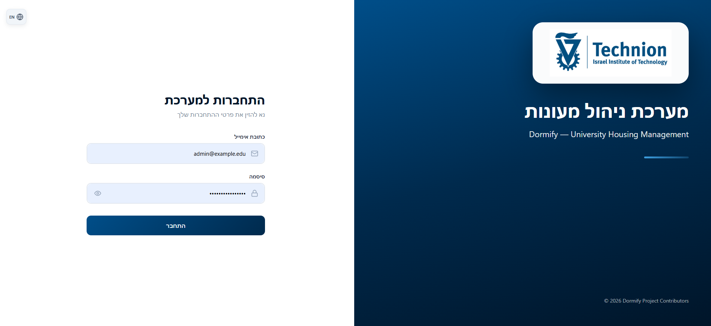
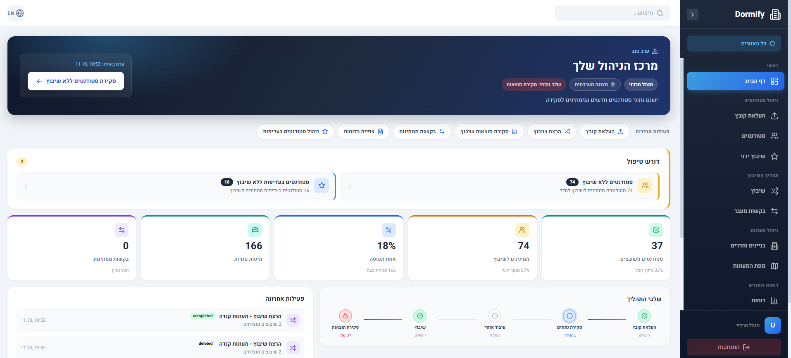
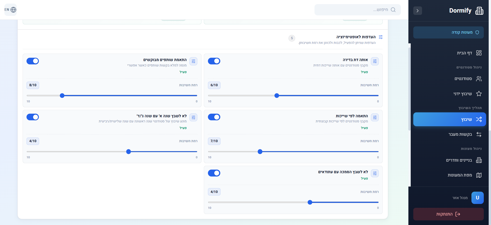
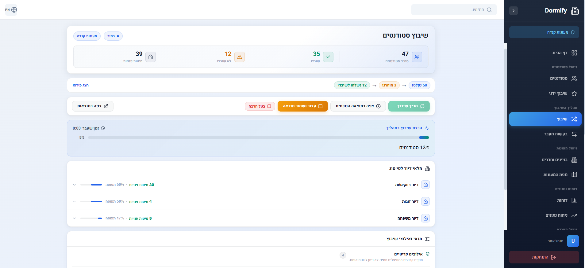
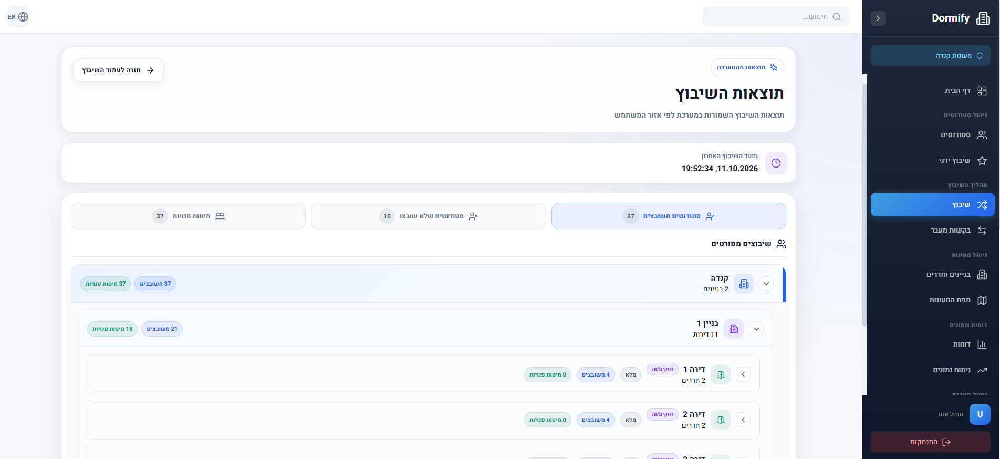
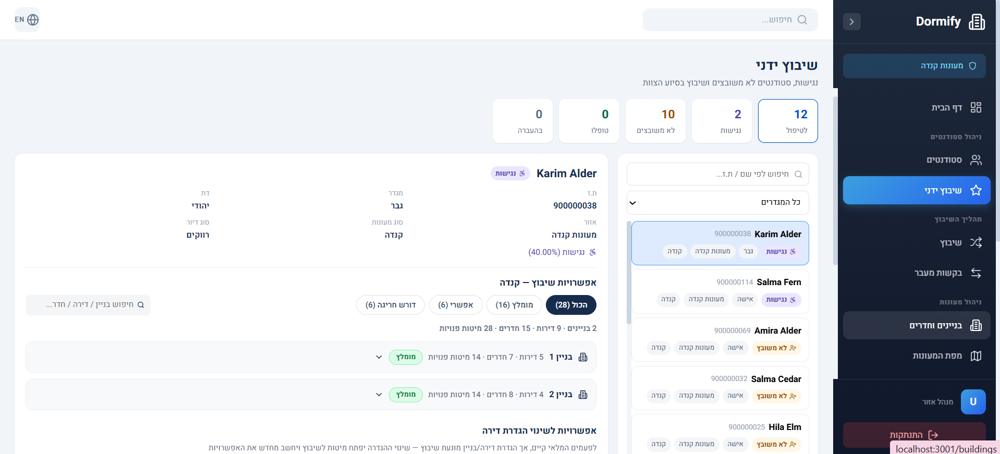
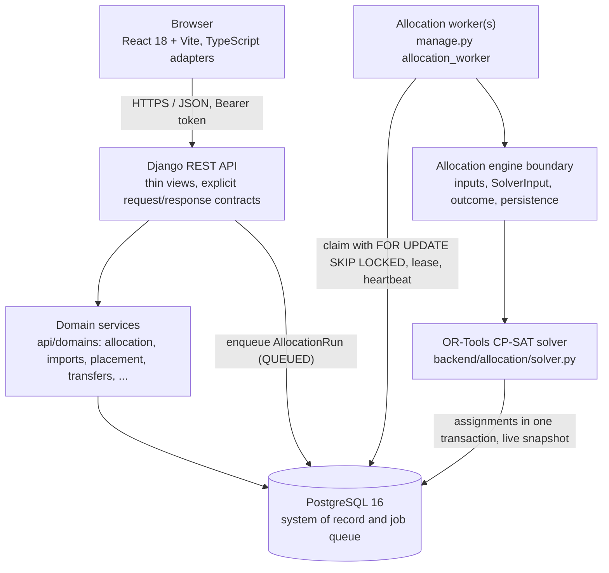

# Dormify

Dormify is a dormitory allocation and housing-management system for a university housing office. It keeps the student population and the physical inventory (regions, dormitory types, buildings, apartments, rooms, beds) in one place, assigns students to beds with a constraint-solver, and gives staff the tools to handle everything the solver cannot decide alone: manual placement, transfers, imports, reports and what-if planning. The system is bilingual (Hebrew and English) and was developed in collaboration with the Technion Dormitories Office, which manages several dormitory regions with separate staff.

The repository contains the complete system: a React frontend, a Django REST backend, the OR-Tools allocation engine, a durable background worker, the PostgreSQL schema and the test suites that protect them.

## Contents

- [Deployment and institutional handover](#deployment-and-institutional-handover)
- [Product preview](#product-preview)
- [Features](#features)
- [Project origin and team](#project-origin-and-team)
- [Independent Post-Project Engineering](#independent-post-project-engineering)
- [Architecture](#architecture)
- [Tech stack](#tech-stack)
- [Engineering decisions](#engineering-decisions)
- [Project structure](#project-structure)
- [Running it locally](#running-it-locally)
- [The allocation worker](#the-allocation-worker)
- [Core workflow](#core-workflow)
- [Testing and quality](#testing-and-quality)
- [API](#api)
- [Security, roles and regional isolation](#security-roles-and-regional-isolation)
- [Limitations and known issues](#limitations-and-known-issues)
- [Documentation map](#documentation-map)
- [License](#license)

## Deployment and institutional handover

Dormify was developed in collaboration with the Technion Dormitories Office and progressed beyond the academic prototype stage. At the end of the student project it was deployed on Technion Computing and Information Systems (CIS) infrastructure and handed over for institutional use by the Dormitories Office. Technion CIS assumed responsibility for the institutional deployment environment, and continued technical ownership of that deployment, after the student-project phase.

This repository is the sanitised engineering and portfolio version of the system. Production credentials, operational student data, confidential institutional material and internal deployment details are intentionally excluded; the Compose stack, environment template and seed script exist so the system can be run and reviewed on synthetic data. The README makes no claim about the current operational status of the institutional deployment.

## Product preview

The screenshots below follow one allocation cycle in the Hebrew interface, taken from a fresh local installation running the synthetic demo data set (`backend/seed.py` plus the generated student workbook, see [Running it locally](#running-it-locally)). Every name, identifier, e-mail address and number shown is synthetic; nothing comes from real student records or from any institutional deployment. The Technion logo on the login screen identifies the academic project context in which Dormify was created (see [NOTICE.md](NOTICE.md)); the repository is not an official Technion software distribution. The institution-owned dormitory map is not published; the map page draws over a schematic placeholder.

**1. Login.** The entry point: a bilingual page (Hebrew shown, English one toggle away) with the project's academic context and a synthetic demo account.



**2. Dashboard.** The central administrator's operational overview after the synthetic import: students waiting for placement, assigned students, free beds, occupancy, open requests, the process stages and recent activity, all scoped to the regions the signed-in role may see.



**3. Allocation preferences.** The soft preferences a regional manager configures before a run (roommate requests, same religion, sector, year mix, program preference), each with its own weight; the hard rules are not configurable here.



**4. Live allocation.** A durable background run in progress for one region: the population funnel (students received, excluded, sent to the solver), the live counts of the best solution found so far, elapsed time, and the controls to view the current solution, stop and keep it, or cancel.



**5. Allocation results.** The saved result as a navigable hierarchy (dorm type > building > apartment > room), with assigned and unassigned student counts and the remaining free beds per level.



**6. Assisted allocation.** The workbench for what the solver leaves to staff: unassigned students and accessibility cases, with ranked building recommendations, an explanation of each option and the audited override path.



## Features

Everything below is implemented and exercised by the test suites.

- **Student management.** Searchable, filterable student list with counts per category; detail editing; students are never hard-deleted (a request workflow ends an assignment instead).
- **Excel imports.** Main population file and an additions file, processed as tracked import batches with progress, stop, stop-and-delete and delete controls; each region receives the rows that concern it in a region inbox.
- **Inventory hierarchy.** Region > dormitory type > building > apartment > room > bed, with activation flags, reserved apartments, bulk inventory creation per building and edit locks that protect occupied housing.
- **Automatic allocation.** A CP-SAT solve over the region's unassigned students and active beds. Hard rules (gender, requested religious placement, capacity, inactive housing, reserved-apartment eligibility, priority-first) are never violated; soft preferences (roommate requests, same religion, sector, year mix, program preference) are weighted and configurable per run. Operators choose a maximum search time, watch a live preview of the best solution found so far, and can cancel, or stop and keep the best feasible result. Unassigned students can be re-solved against the current inventory. The rules are listed in [docs/ALLOCATION_RULES.md](docs/ALLOCATION_RULES.md).
- **Allocation results.** Per-run results as a navigable tree with totals, warnings and population diagnostics; draft results can be deleted before approval.
- **Assisted (manual) allocation.** A workbench for students the solver could not place and for accessibility cases the solver deliberately leaves to staff: ranked recommendations, an explanation of why a placement is blocked, and an audited override path for administrative exceptions.
- **Transfer requests.** Room changes, apartment transfers, cross-region moves, student swaps and add/remove-student requests, with feasibility checks, matching room options and approve/reject/cancel transitions revalidated server-side.
- **Buildings and rooms.** Direct assign, move, unassign and swap of students with occupancy and compatibility checks.
- **Dashboard, analysis and map.** A role-aware home page, a data-analysis page over occupancy and population, and a dormitory map with interactive occupancy overlays (drawn over a schematic placeholder in this repository).
- **What-if planning.** Simulate deactivating buildings or changing availability, see which students are affected, then confirm the change as transfer requests.
- **Reports.** Excel exports: a system-wide report for central administrators, and per-region student-allocation, student-actions, capacity and manual-review reports.
- **Roles and regions.** Central administrators see everything; regional managers and employees see and act only within their region, enforced by the backend on every endpoint.

## Project origin and team

Dormify was originally developed as a final-year Information Systems Engineering project at the Technion - Israel Institute of Technology, in collaboration with the Technion Dormitories Office. The original project team:

- Donia Hassan
- Maha Kadah
- Aya Abu-Raya
- Zeinab Habiballah
- Siraj Sulieman

The product, its allocation model and core workflows, and the original implementation, including the deployment and handover work, are the work of this team.

## Independent Post-Project Engineering

After the academic project was completed and handed over, Donia Hassan began a separate post-project engineering effort in this repository, building on the original system created by the project team.

This later work focused on architecture, maintainability, reliability, security and production-readiness while preserving the original product behaviour:

- safer, reproducible local and test environments, with isolated PostgreSQL and Docker resources and a safeguard against unintended use of a shared or production database;
- dependency and engineering-tooling modernization: vulnerability auditing, removal of vulnerable and unused dependencies, pinned and reproducible dependency validation, Ruff, pre-commit checks, TypeScript type checking, and lint, type and test gates in CI;
- a typed, feature-oriented frontend: incremental TypeScript adoption, a shared API client with typed contracts, feature adapters and normalization helpers, shared localization, styling and test infrastructure, and decomposition of large React pages into focused feature modules, hooks and components;
- thin backend HTTP views with explicit domain, query and service boundaries;
- explicit, test-pinned frontend/backend API contracts;
- defined input, output and persistence boundaries around the existing OR-Tools allocation engine;
- durable PostgreSQL-backed allocation jobs executed by a dedicated worker, with transactional claiming, leases, heartbeat, crash recovery and stale-worker fencing;
- expanded domain, contract, security, concurrency, performance and regression validation, with stricter CI protection, including a full-pass allocation regression gate and clean-working-tree checks;
- a new documentation set, fresh-clone reproducibility verification and release-readiness improvements.

In sequence: the original team project, developed with the Technion Dormitories Office; institutional deployment on Technion CIS infrastructure and the formal handover; completion of the academic project; then the independent post-project engineering recorded in this repository, referred to as Dormify v3. The reasoning behind its main changes is recorded under [Engineering decisions](#engineering-decisions).

## Architecture



How the layers relate:

- **Frontend: features and adapters.** `frontend/src/features/<feature>/` owns a page, its components, hooks and one typed API adapter built on a single shared Axios client (`shared/api/client.ts`). Response shapes are hand-maintained TypeScript contracts (`shared/api/contracts/`) that mirror the backend serializers field for field.
- **Backend: HTTP boundary and domains.** Views in `api/views/` parse the request, authorize, call a domain function and map the result to a response; the parsers and error-body builders live in `api/contracts/`. Business rules, queries and read models live in `api/domains/` and never import the HTTP layer.
- **Allocation engine boundary.** `api/domains/allocation/` builds the solver population (`inputs`), the complete solver call (`engine.SolverInput`), reads the result (`SolverOutcome`) and persists the run outcome (`persistence`). The solver itself (`backend/allocation/solver.py`) only solves and writes assignments; it is unaware of HTTP and of the worker.
- **Durable background execution.** Starting an allocation only creates a QUEUED `AllocationRun` row that carries its solver parameters. A separate worker process claims it from PostgreSQL, holds a renewable lease while it executes, and recovers runs whose worker disappeared. The web process never runs the solver; preview, cancel and stop-and-save all go through the database, so any web replica can serve them.
- **PostgreSQL as queue, lease and fence.** `AllocationRun` is the job record. A claim increments `attempts` and records `claimed_by`; that pair is the claim generation every write of a worker execution is conditional on, so a worker that lost its lease can neither persist assignments nor overwrite another worker's outcome.

## Tech stack

| Area | Technology | Role in Dormify |
|---|---|---|
| Frontend | React 18, React Router 7, Vite 8 | Single-page application; Vite serves development and builds the production bundle. |
| Frontend typing | TypeScript 5.9 (incremental, strict for `.ts`/`.tsx`) | Typed API adapters, contracts and shared infrastructure; legacy pages remain `.jsx` and are migrated feature by feature. |
| HTTP client | Axios 1.x | One shared client with the access token in memory and the refresh-cookie flow; every feature adapter uses it. |
| Frontend tests | Vitest 4, Testing Library, jsdom, axios-mock-adapter | Component and adapter tests against mocked HTTP. |
| Backend | Python 3.11, Django 5.2, Django REST Framework 3.17 | API, ORM, migrations, admin. |
| Authentication | djangorestframework-simplejwt 5.5 | Short-lived Bearer access tokens; refresh token as an HttpOnly cookie with rotation and blacklist. |
| Database | PostgreSQL 16 (psycopg2) | System of record, and the durable allocation job queue (row locks, `SKIP LOCKED`). |
| Optimisation | Google OR-Tools CP-SAT 9.10 | The allocation model: hard constraints plus a weighted objective. |
| Data files | pandas 2.1, openpyxl | Excel import parsing and report generation. |
| Containers | Docker, Docker Compose | Reproducible local stack: database, API, allocation worker, frontend, and an isolated test database. |
| Quality tooling | Ruff, pre-commit, pip-audit, npm audit, GitHub Actions, Dependabot | Lint, hooks, dependency audits and CI. |

Node 20.20.2 (npm 10) is the supported frontend toolchain (`frontend/Dockerfile`, CI); `package.json` requires Node 20.19 or newer.

## Engineering decisions

Each item records why the choice was made, not just what exists.

- **Feature-oriented frontend.** The original frontend was a flat set of large page files. It was decomposed into `features/<feature>/` units (page, components, hooks, adapter, types, tests) so a change to transfers cannot silently alter allocation, and so each page can be tested with its own mocked API.
- **Incremental TypeScript.** Rewriting every page at once would have risked the product. New infrastructure and adapters are strict TypeScript; existing `.jsx` pages compile under `allowJs` and are converted when they are touched. Type checking runs in CI.
- **One HTTP client, typed adapters, hand-written contracts.** All requests go through one Axios instance (auth header, refresh handling, error flattening). Response types are written by hand from the serializers and pinned by backend contract tests rather than generated: the backend has no OpenAPI schema, and adding a schema generator was judged a larger dependency than the project needed.
- **Thin views, domain modules.** Views do HTTP only. Business rules moved to `api/domains/` where they are tested directly, and the former thick views are protected by characterization tests that pin their behaviour so the extraction could be verified rather than trusted.
- **Explicit contract tests instead of OpenAPI.** `api/tests/contracts/` pins status codes, response keys, key order, error bodies and permissions for every endpoint the frontend consumes. This made the later backend refactors verifiable without introducing schema tooling.
- **A boundary around the solver.** The solver is a large, carefully validated CP-SAT model whose expected assignments are pinned by 210 tests. Everything around it (population loading, the call shape, result reading, persistence of the run outcome) was made explicit so orchestration could change while the algorithm did not.
- **PostgreSQL-backed job queue, no broker.** Background runs used to execute on a daemon thread inside the web process and died with it. The fix needed durability, not throughput: one database the system already has, `SELECT ... FOR UPDATE SKIP LOCKED` for claiming, a lease renewed by a heartbeat, and recovery on lease expiry. Redis, Celery or RabbitMQ would have added infrastructure for a queue that rarely holds more than a handful of jobs.
- **AllocationRun as the job record.** The run row already owned the lifecycle states, timestamps, diagnostics and live snapshot; adding the solver parameters and lease fields to it avoided a second table and kept one source of truth that the UI already polls.
- **Claim generations and fencing.** A lease alone does not stop a worker that merely lost its network connection for a while. Every write of a worker execution, including the solver's persistence transaction, is conditional on the claim generation `(claimed_by, attempts)`; a stale worker fails closed. Recovery is deliberately conservative: it re-runs a solve only when provably nothing was written, and otherwise fails the run explicitly.
- **Persisted live preview.** The solver mirrors its best solution so far into the run row. Because the web process and the worker share no memory, the preview endpoint reads only that persisted snapshot, which also makes it correct behind several web replicas.
- **Regional data isolation on the server.** Region scope is resolved from the authenticated user, never trusted from the request. A regional user asking for another region receives a clear 403 rather than silently substituted data, so a wrong answer cannot be mistaken for the right one.
- **Reproducible Docker development, with a guard.** Compose supplies literal database values to its containers, and a local-database-only guard makes host processes refuse any database host that is not explicitly local, so development and tests cannot reach a shared database by accident.

## Project structure

```text
dormify/
├── frontend/
│   └── src/
│       ├── app/                   # routing, header, sidebar, navigation registry
│       ├── features/              # one folder per product area: allocation, analytics, auth,
│       │                          #   dashboard, inventory, map, reports, settings, staff,
│       │                          #   students, transfers, uploads, what-if
│       │   └── <feature>/         # page, components/, hooks/, api.ts (adapter), types.ts, tests
│       └── shared/
│           ├── api/               # Axios client, hand-written contracts, response normalizers
│           ├── i18n/              # Hebrew/English language handling
│           ├── lib/               # small shared helpers (class names, gender and location labels)
│           ├── styles/            # design tokens and global styles
│           └── test/              # render helpers with a mocked API
├── backend/
│   ├── api/
│   │   ├── contracts/             # request parsers and error-body builders (the HTTP contract)
│   │   ├── domains/               # business logic by area: allocation (engine boundary, jobs,
│   │   │                          #   worker, fencing), imports, inventory, placement, transfers,
│   │   │                          #   assisted, matching, analytics, reports, students, whatif
│   │   ├── views/                 # thin HTTP views, one module per area
│   │   ├── serializers/           # DRF serializers, one module per resource area
│   │   ├── management/            # allocation_worker, run_allocation_case, materialize_beds
│   │   ├── migrations/
│   │   ├── tests/                 # functional, characterization, allocation, assisted_allocation,
│   │   │                          #   security, performance, concurrency, domains, contracts
│   │   └── models.py, urls.py, permissions.py, throttling.py
│   ├── accounts/                  # staff-account management endpoint
│   ├── allocation/                # OR-Tools CP-SAT solver, manual-placement rules, live registry
│   ├── canada_algorithm_tests/    # controlled solver scenarios with expected results
│   ├── dormify/                   # settings, URL root, database safety guard
│   ├── scripts/                   # generate_demo_students.py: synthetic student workbook
│   └── seed.py                    # synthetic demo regions, dorm types, inventory, staff accounts
├── .github/workflows/             # GitHub Actions: CI, scheduled validation, dependency audit
├── scripts/ci/                    # CI and audit helpers: allocation-suite runner, dependency audit
├── docs/                          # allocation rules, API, security, worker, testing, development
├── docker-compose.yml
├── .env.example
├── .pre-commit-config.yaml
├── LICENSE
├── NOTICE.md
└── README.md
```

## Running it locally

Prerequisites: Git, Docker with Docker Compose. For host-side frontend or backend work you also need Node 20.20 (npm 10) and Python 3.11.

### Docker Compose (recommended)

First run, in this order:

```bash
git clone <repository-url> dormify
cd dormify
cp .env.example .env                                                        # host-side defaults; Compose containers do not read it
docker compose -p dormify-v3 up -d db                                       # 1. database (PostgreSQL 16, loopback port 5434)
docker compose -p dormify-v3 run --rm --build backend python manage.py migrate   # 2. schema, before any worker polls
docker compose -p dormify-v3 up --build                                     # 3. full stack: db, backend, allocation_worker, frontend
```

Step 3 starts `backend` (Django development server, http://localhost:8001), `allocation_worker` (same image, `manage.py allocation_worker`) and `frontend` (Vite, http://localhost:3001). Applying the schema first matters on a blank database: the worker starts polling for queued runs immediately, so if the full stack is brought up before `migrate` it logs missing-table errors until the migrations finish. That is harmless (the worker keeps polling and recovers by itself), but it looks alarming on a first run. Then, in a second terminal, create the synthetic demo data:

```bash
docker compose -p dormify-v3 exec backend python seed.py                       # 4. regions, dorm types, inventory, staff accounts (or: python manage.py createsuperuser)
docker compose -p dormify-v3 exec backend python scripts/generate_demo_students.py   # 5. synthetic student workbook
```

`backend/seed.py` creates synthetic demo regions, dormitory types, buildings, apartments, rooms, beds and one staff account per role; it refuses to run unless `DEBUG=True` and prints the generated passwords once. `backend/scripts/generate_demo_students.py` writes a synthetic student workbook (`backend/demo-data/demo_students.xlsx`, git-ignored, deterministic for a given `--seed` and `--count`) in the dorm-office import format; upload it on the Students import page as the central administrator, then run an allocation as a regional manager. Everything the two scripts produce is synthetic. On later runs, `docker compose -p dormify-v3 up` alone is enough. Stop everything with `docker compose -p dormify-v3 down`.

Always pass `-p dormify-v3`: the Compose file pins the project name, but `COMPOSE_PROJECT_NAME` or `-p` can override it, and the persistent volumes are explicitly named so they can never be adopted by another project.

The development database lives in the named Docker volume `dormify-v3-dev-pgdata`, which survives `down` and restarts by design. Because the name is fixed by the Compose file, a fresh clone of the source code is not automatically a blank database: a second checkout on the same machine reuses the volume, together with the migrations, seed data and imports that an earlier checkout created. Do not delete the volume casually. A reviewer who needs a clean-room database should point the stack at an isolated volume name through a Compose override, or deliberately remove the local volume knowing that its data is lost; both procedures are in [docs/DEVELOPMENT.md](docs/DEVELOPMENT.md).

### Host-side development

Run the database in Compose and the application processes on the host when you want hot reload and debuggers:

```bash
docker compose -p dormify-v3 up -d db
cd backend && python -m venv .venv && . .venv/bin/activate      # Windows: .venv\Scripts\activate
pip install -r requirements.txt -c constraints.txt
python manage.py migrate && python manage.py runserver           # http://localhost:8000
python manage.py allocation_worker                               # second terminal
cd ../frontend && npm ci && npm start                            # http://localhost:3001
```

The root `.env` (copied from `.env.example`) configures host processes: database on `localhost:5434`, `VITE_API_URL=http://localhost:8000/api`, `DEBUG=True`, and the local-database-only guard. Values already exported in your shell take precedence over `.env`. Details, ports and troubleshooting are in [docs/DEVELOPMENT.md](docs/DEVELOPMENT.md).

## The allocation worker

`python manage.py allocation_worker` is the process that executes allocation runs. The web request that starts a run only creates a QUEUED `AllocationRun` with its parameters and returns; the worker claims it from PostgreSQL, executes it through the allocation engine boundary, and records the outcome. Separating the two means a run survives request completion and web-process restarts, several web replicas can serve status, preview and stop requests, and workers can be scaled independently.

- `--once` performs a single cycle (recover stale runs, execute at most one queued run) and exits; without it the worker polls until SIGTERM or Ctrl+C and lets the run in progress finish first.
- Several workers may run against the same database: `docker compose -p dormify-v3 up --scale allocation_worker=2`. Each queued run is claimed by exactly one of them.
- A worker holds a lease on the run it executes and renews it from a heartbeat thread. If a worker dies, its lease expires and another worker recovers the run: re-queued if the solver had not started, otherwise marked failed with an explicit message (a solve is never silently repeated).
- Tunables: `ALLOCATION_WORKER_POLL_INTERVAL_SECONDS`, `ALLOCATION_WORKER_LEASE_SECONDS`, `ALLOCATION_WORKER_HEARTBEAT_SECONDS`, `ALLOCATION_WORKER_MAX_ATTEMPTS` (defaults in `.env.example`).
- Deployment order for the schema that introduced the worker: apply migration `0020`, start workers, then roll out new web code. Old web code keeps working against the new schema.

Lifecycle, recovery policy, fencing and logging are documented in [docs/ALLOCATION_WORKER.md](docs/ALLOCATION_WORKER.md).

## Core workflow

1. A central administrator imports the student population from Excel; each region's rows land in that region's inbox.
2. Regional staff review buildings, apartments and rooms, activating or reserving housing as needed.
3. A regional manager starts an allocation for the region, chooses the maximum search time and the soft-preference weights, watches the live preview, and either lets the solve finish, stops it keeping the best result, or cancels it.
4. Results are reviewed in the results tree; unassigned students can be re-solved, or placed through the assisted-allocation workbench (including accessibility cases the solver never touches).
5. Day-to-day changes go through transfer requests, direct room actions and what-if simulations; reports and the analysis page summarise the state of each region.

## Testing and quality

The backend test suites run against an isolated PostgreSQL database; the frontend suites run under Vitest with the HTTP layer mocked.

| Suite | Tests | What it protects |
|---|---|---|
| `api.tests.functional` | 168 | End-to-end API behaviour of each area |
| `api.tests.characterization` | 200 | Pinned behaviour and architecture of the views package and the allocation run body |
| `api.tests.allocation` | 210 | The solver's expected assignments and the run lifecycle (real OR-Tools) |
| `api.tests.assisted_allocation` | 63 | The assisted workbench and placement rules |
| `api.tests.security` | 88 | Roles, regional isolation, JWT lifecycle, throttles, settings |
| `api.tests.performance` | 65 | Query counts and N+1 guards |
| `api.tests.concurrency` | 24 | Races on requests, placements and load |
| `api.tests.domains` | 177 | Domain services directly, including the durable worker, leases, recovery and fencing, and the synthetic student generator |
| `api.tests.contracts` | 86 | HTTP contracts of every frontend-consumed endpoint |
| full discovery (`manage.py test`) | 1081 | all of the above |
| frontend (`npm test`) | 33 files / 321 tests | pages, adapters and contracts |

```bash
# backend (isolated test database on port 5435; see docs/TESTING.md for .env.test)
docker compose -p dormify-v3 --profile local-db up -d test_db
cd backend && ENV_FILE=.env.test python manage.py test            # or one label, e.g. api.tests.domains

# frontend
cd frontend && npm ci && npm run typecheck && npm run lint && npm test && npm run build

# repository checks and audits
pre-commit run --all-files
python scripts/ci/dependency_audit.py python --fail-on any && python scripts/ci/dependency_audit.py npm --fail-on high
```

Beyond the automated suites, a manual walkthrough of the synthetic-data workflow (fresh clone, blank database, migrations, seed, generated workbook import, dashboard, student list, regional isolation, a complete regional allocation, results and the assisted workbench) was completed on the v3 tree; the screenshots in [Product preview](#product-preview) come from that run and its scope is recorded in [docs/TESTING.md](docs/TESTING.md).

The performance and concurrency suites contain wall-clock assertions and should run without heavy competing load on the host. CI runs lint and Django checks, the functional, characterization, security, assisted-allocation, domains and contracts suites, the complete allocation suite (every test must pass), the performance suite and the frontend pipeline; the concurrency suite runs on a weekly schedule. The dependency audits are a blocking gate on every push and pull request (any Python finding, high or critical npm findings) and advisory on their weekly scheduled run. Full details: [docs/TESTING.md](docs/TESTING.md).

## API

The API is a JSON REST API under `/api/`, authenticated with a Bearer access token. Endpoint families: authentication and account, staff accounts, students, inventory (regions, dorm types, buildings, apartments, rooms, beds), imports and the region inbox, allocation runs and results, assisted allocation, room actions, transfer requests, what-if, analysis and dashboard, and Excel reports. Each family, its roles and its error behaviour is documented in [docs/API.md](docs/API.md), which also separates the endpoints the frontend uses from operational and legacy surfaces. `backend/api/urls.py` is the authoritative route list.

## Security, roles and regional isolation

Three roles: `central_admin` (every region, staff management, system-wide reports), `region_boss` (runs allocations, reviews requests and manages staff within one region) and `employee` (operates within one region). Region scope is derived from the authenticated user on the server; a client-supplied region is only honoured for central administrators. Authentication uses a 20-minute JWT access token kept in frontend memory plus an HttpOnly, path-scoped refresh cookie with rotation and server-side blacklisting; login, refresh, logout and account changes are rate-limited; public self-registration does not exist. Production hardening (HTTPS redirect, HSTS, secure cookies) activates when `DEBUG=False`, and the application refuses to start without a real `SECRET_KEY` in that mode. Details and the list of what the security suite proves: [docs/SECURITY.md](docs/SECURITY.md).

## Limitations and known issues

- One worker process executes one allocation run at a time; parallelism comes from running several workers.
- A run whose worker is lost mid-solve is failed explicitly rather than re-solved; the operator starts a new run. This is deliberate.
- The legacy synchronous allocation endpoint (`POST /api/allocation/run/`) still exists but is not used by the frontend; its assignments are not tagged with the run. The queued worker path is the supported one. Retiring the endpoint is an owner decision.
- Soft-preference weights are chosen per run; there is no persisted per-region configuration (the former in-memory conditions endpoint is unrouted).
- The allocation code paths still print progress diagnostics (run ids, counters, solver status) to stdout alongside the worker's structured logging; request bodies and per-student data are not printed.
- Docker Compose here is a development stack (`runserver`, Vite dev server, `restart: "no"`); a production deployment (WSGI server, static frontend, managed PostgreSQL, HTTPS) is not part of this repository.

## Documentation map

| Document | Content |
|---|---|
| [docs/DEVELOPMENT.md](docs/DEVELOPMENT.md) | Environment variables, ports, host-side setup, troubleshooting |
| [docs/ALLOCATION_RULES.md](docs/ALLOCATION_RULES.md) | Hard constraints, soft preferences and their defaults, search and result behaviour |
| [docs/ALLOCATION_WORKER.md](docs/ALLOCATION_WORKER.md) | Worker lifecycle, claiming, leases, recovery, fencing, logging, deployment order |
| [docs/API.md](docs/API.md) | Endpoint families, roles, request fields, responses, error behaviour, legacy surfaces |
| [docs/SECURITY.md](docs/SECURITY.md) | Roles, regional isolation, authentication, hardening |
| [docs/TESTING.md](docs/TESTING.md) | Suites, test counts, commands, CI |
| [backend/README.md](backend/README.md) | Backend-specific commands and layout |
| [backend/canada_algorithm_tests/README.md](backend/canada_algorithm_tests/README.md) | Controlled solver scenarios and expected results |

## License

Dormify is source-available for viewing, not open source. The code may be read for portfolio, academic, research-discussion and technical-review purposes; all rights remain reserved by the relevant contributors and rights holders, and no general permission is granted to copy, modify, redistribute, sublicense, sell, deploy, host or commercially exploit it. The exact terms are in [LICENSE](LICENSE); [NOTICE.md](NOTICE.md) records authorship, the sanitised scope of this snapshot and the Technion trademark disclaimer.
